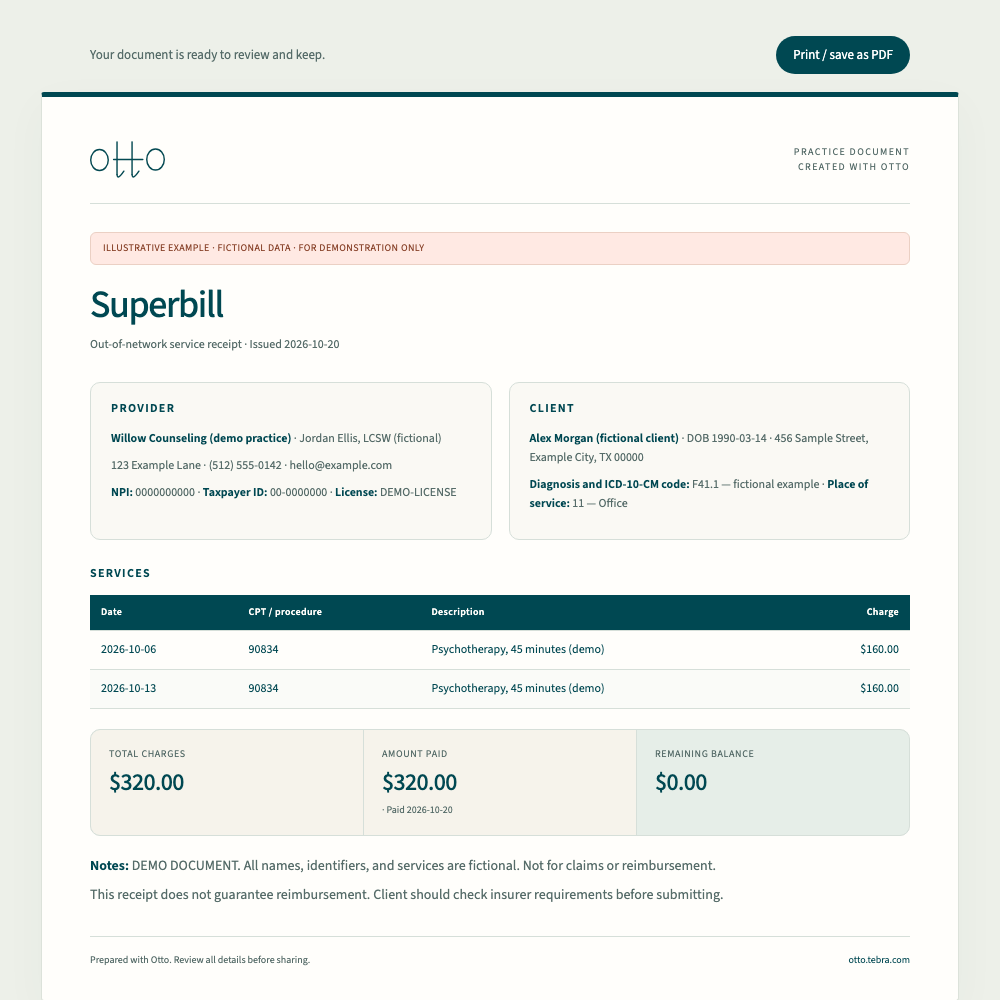

# Astro migration validation

Validated locally on October 20, 2026, starting from the selected `gtm-seo-play` snapshot at commit `919924a`.

- All 35 routes build as static HTML. A one-time text comparison confirmed that every page’s main content matches the selected snapshot.
- Astro type checks passed with no errors or warnings. Three unused-variable hints remain in preserved calculator scripts.
- Five static validation groups passed in preview mode and with production indexing enabled against `https://release-check.example`. Checks include every local link, asset and anchor, per-page metadata, JSON-LD parsing, sitemap exclusions, hidden pricing, and the demo signup’s lack of network submission.
- All 18 Playwright tests passed across desktop and mobile. They cover rendering every route, no page overflow or broken images, keyboard navigation, conditional signup fields, three tool downloads, SOAP/DAP downloads, video metadata, and 404 responses.
- Desktop product/tools pages, mobile article/product/tools pages, and a generated superbill were inspected visually.
- Wrangler’s deployment dry run passed. The local Cloudflare runtime served the pages and assets successfully, redirected the slashless product URL, and returned 404 for an unknown route and `/api/waitlist`.
- The 132-second demo video was encoded from the existing source to H.264/AAC at 720p with fast-start metadata. The new file is 6,203,330 bytes, below Cloudflare’s 25 MiB per-file limit.

No Cloudflare deployment, custom-domain routing, application change, or real lead collection was performed.

## Visual evidence

